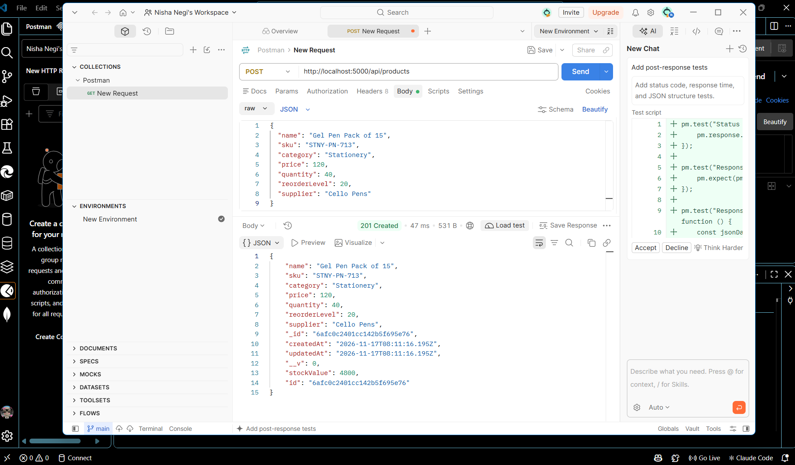
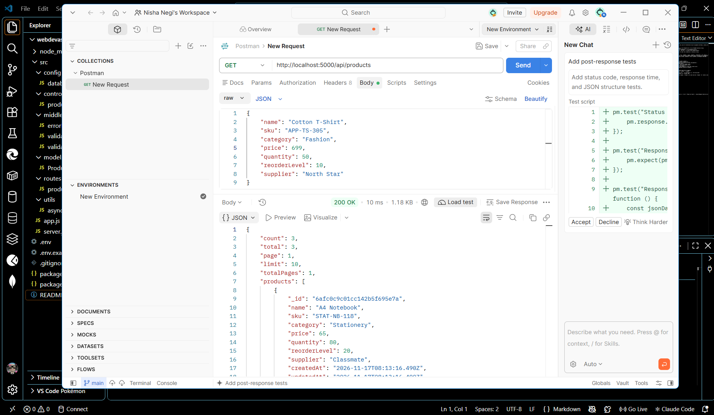
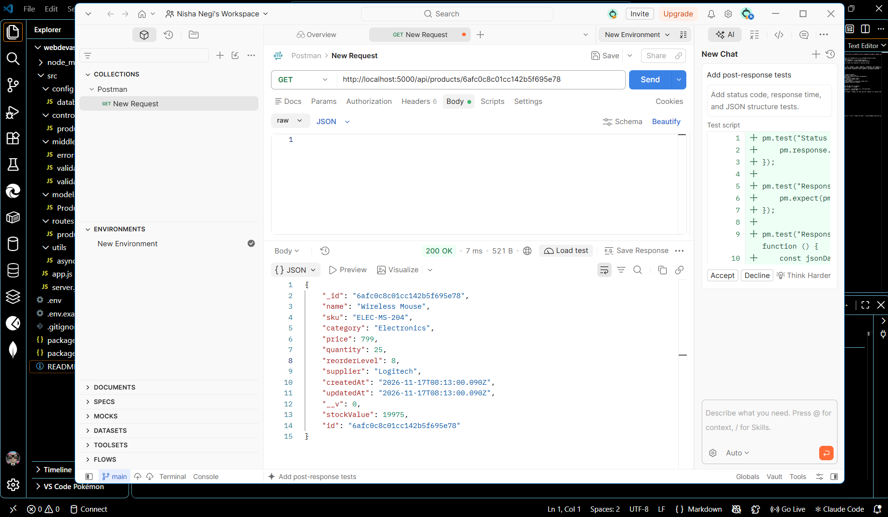
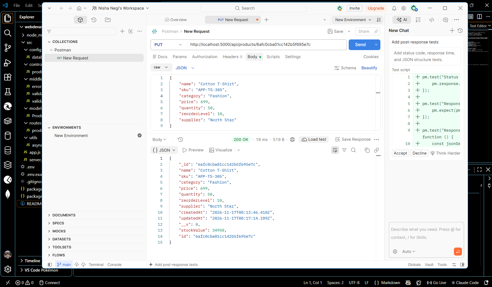
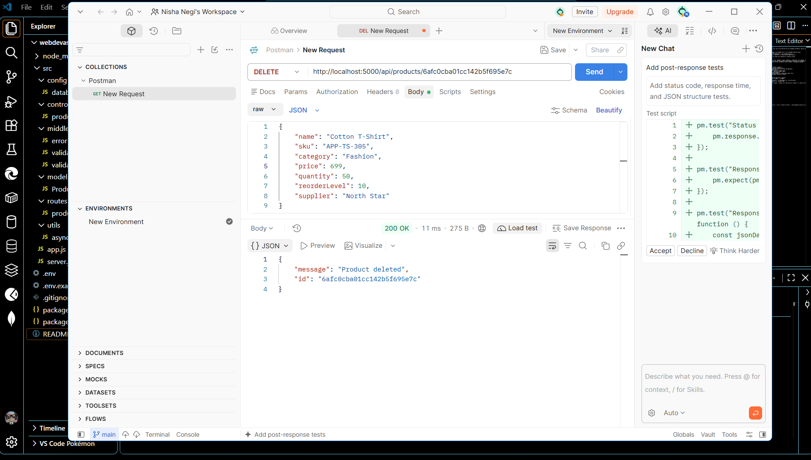
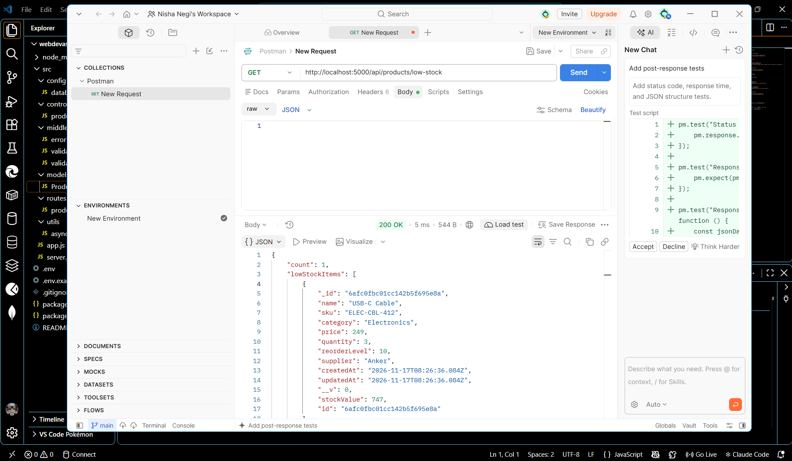
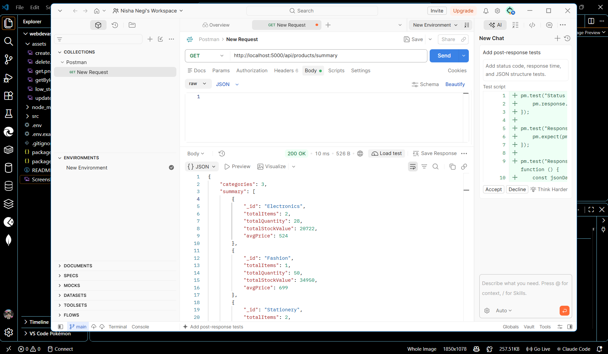

# Inventory and Data Management System

A REST API for managing products and stock, built for the Web Dev III Lab 3 assignment with Node.js, Express, Mongoose, and MongoDB.

## Run locally

1. Install Node.js 18 or newer and start a local MongoDB server (or use a MongoDB connection string).
2. Install dependencies with `npm install`.
3. Copy `.env.example` to `.env` and set `MONGODB_URI` if your MongoDB URL differs.
4. Start the API with `npm run dev` (or `npm start`). It listens on port 5000 by default.

The `.env` file is ignored by Git. Do not commit real credentials or connection strings.

## Product fields

Product requests use JSON with `name`, `sku`, `category`, `price`, `quantity`, `reorderLevel`, and `supplier`. All fields are required when creating a product. Quantity and reorder level must be non-negative whole numbers; price must be a non-negative number; SKU values are unique and stored in uppercase. Responses include `stockValue` (`price * quantity`) and Mongoose timestamps.

## API routes

| Method | Path | Purpose |
| --- | --- | --- |
| `POST` | `/api/products` | Create a product (returns `201`) |
| `GET` | `/api/products` | List products with filtering, sorting, and pagination |
| `GET` | `/api/products/:id` | Get one product |
| `PUT` | `/api/products/:id` | Update one or more product fields |
| `PATCH` | `/api/products/:id/stock` | Restock or record a sale |
| `DELETE` | `/api/products/:id` | Delete a product |
| `GET` | `/api/products/low-stock` | Find products at or below their reorder level |
| `GET` | `/api/products/summary` | Aggregate inventory by category |

## API screenshots

### Create product



### Get all products



### Get product by ID



### Update product



### Delete product



### Low-stock report



### Summary



List query parameters:

- `category`, `supplier`, `search` (matches name, SKU, or supplier)
- `minPrice` / `maxPrice` (also accepts `priceMin` / `priceMax`)
- `minQuantity` / `maxQuantity`
- `sort` (comma-separated fields; prefix with `-` for descending, e.g. `sort=-price,name`)
- `page` (default `1`) and `limit` (default `10`, maximum `100`)

Stock changes use a signed integer. For example, `{"change": 10}` adds stock and `{"change": -3}` records a sale. The API rejects a sale that would make stock negative.

## Example requests

Create a product:

```json
{
  "name": "Gel Pen Pack of 15",
  "sku": "STNY-PN-713",
  "category": "Stationery",
  "price": 120,
  "quantity": 40,
  "reorderLevel": 20,
  "supplier": "Cello Pens"
}
```

Stock adjustment:

```json
{ "change": -3 }
```

Errors use a consistent JSON shape, such as `{ "error": "Product not found" }`. Invalid Mongoose fields also include a `details` array.
